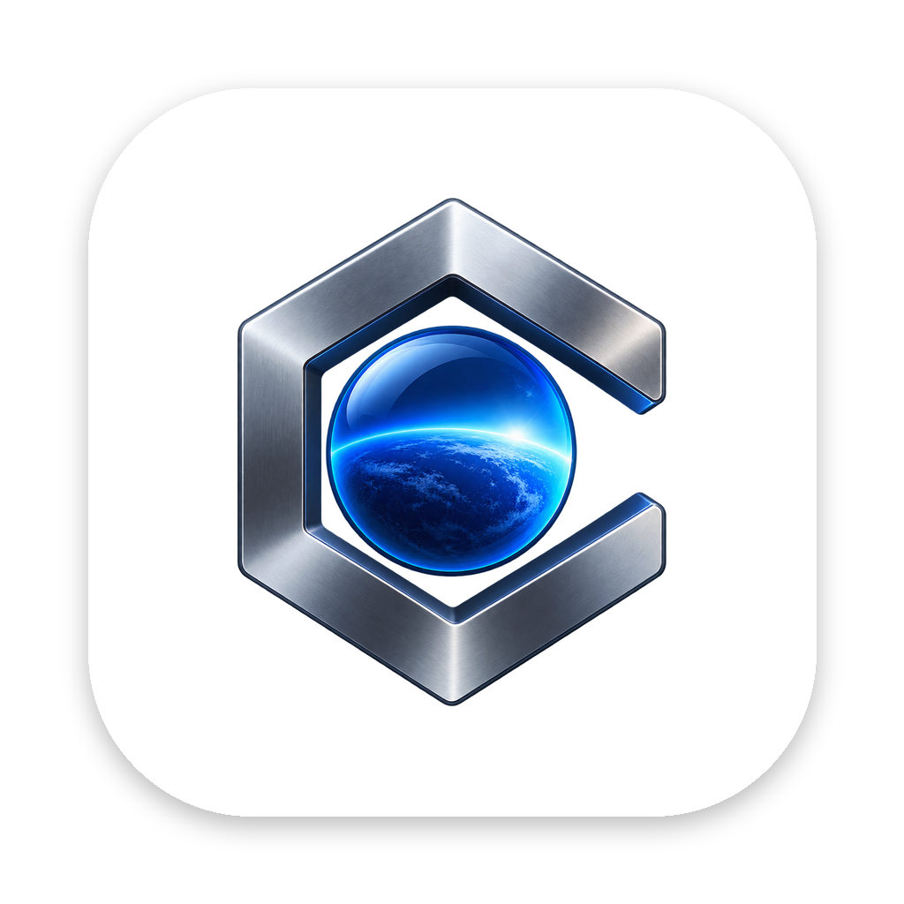
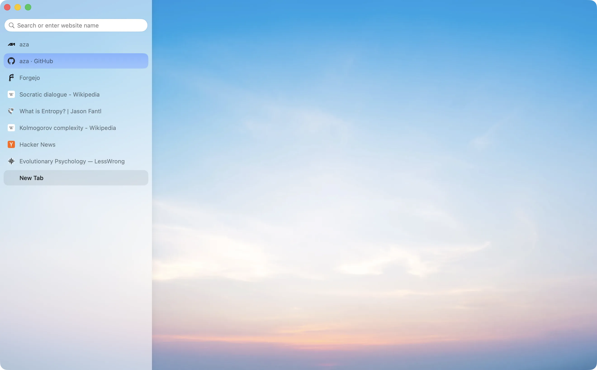

<div align="center">
    
    <h1>Aza Browser</h1>
    <p>
        A private and opinionated macOS browser
    </p>
</div>



## WebKit

Browser uses the system WebKit, with normal JavaScript and WebAssembly JIT compilation and WebRTC behavior. WebKit is updated with the operating system.

- WebKit's baseline, fingerprinting and link-decoration protections are enabled for every navigation through its private API.
- Fingerprint noise is managed by WebKit.
- Web processes use UTC, and the app requests en-US.
- Browser does not request iCloud Private Relay; traffic uses the system network configuration, including your VPN.

## Browser

- Each tab gets its own data store and network session (cookies, all storage, HTTP cache, HSTS, TLS sessions, connections) and its own web process.
- Every reload, typed address and navigation to another site throws that identity away and loads into a new one; links, back and forward within one site keep it, cache and connections included.
- Persist (⌘I) keeps a tab's identity until the tab closes, across relaunches.
- Domains on the cookie whitelist keep one jar on disk, shared by all tabs.
- `window.open` popups (sign-in, 3-D Secure) share their opener's identity and close with it; links opened in a new tab start fresh.
- The user agent is Safari's for the installed macOS.
- HTTPS-only: plain HTTP is upgraded, with a one-load fallback page if the site has no HTTPS. Loopback (`localhost`) is left alone.
- Tracking parameters (`utm_*`, `fbclid`, `gclid` and others) are removed from every navigation.
- Ads and trackers are blocked inside WebKit's networking by content rules compiled from filter lists (uBlock Origin's, EasyList, EasyPrivacy, Peter Lowe's, URLhaus, AdGuard cookie notices), fetched daily without cookies.
- The lists' scriptlets (`+js(…)`) run from Browser's own library of uBlock Origin's scriptlets, only on the sites a rule names: this is what takes YouTube's ads out.
- Location, notifications, MIDI, USB, serial, HID, Bluetooth and sensors are always denied; camera and microphone ask every time and the answer isn't kept.
- Downloads open the save panel and keep macOS's quarantine flag; about://downloads lists them.
- A file path pasted into the address bar (`/…`, `~/…`, quoted or with Terminal's backslashes, or `file://`) opens the file, with the images, scripts and styles it points to; a web page can never open one.
- Bangs (`!w`, `!gh`, `!yt` and about 300 more) resolve from a table inside the app.
- Favicons are read from the page through WebKit's isolated script world, fetched without cookies, and kept on disk only for sites in History.
- History keeps addresses, titles, visit counts, last-visit times and frecency in SQLite, plus which suggestion you picked for what you typed, for address-bar completion and `about://history`.
- Safari web extensions from apps in Applications turn on in Settings and run on WebKit's extension engine; their own storage is kept.
- Userscripts written for Violentmonkey run built in, with its GM_* and GM.* APIs. Opening a `.user.js` link or file offers Install; `about://userscripts` lists them, each with a switch, beside a code editor.
- No telemetry and no update checks for Browser itself. The only requests Browser makes by itself are the daily filter-list fetch and, at the same time, installed userscripts' update checks.
- No proxy or Tor: use a VPN. Browser does not enable WebKit's iCloud Private Relay policy.

Keyboard shortcuts are at `about://help` (⇧⌘/).

## Build

Requires Apple Silicon, macOS 26 and Xcode 27.

```bash
./build.sh               # release build into build/Browser.app
./build.sh debug         # debug build
./build.sh release ship  # Developer ID sign + notarize -> build/release/Browser-<version>.dmg
```

`ship` needs a Developer ID Application certificate and one-time notary setup:

```bash
xcrun notarytool store-credentials browser
```

Pushing a `v*` tag runs the same build on the Forgejo runner (`.forgejo/workflows/release.yml`). `release/runner.sh <token>` registers this Mac as that runner. Updates are manual.

## Test

The UI self-test only works in debug builds:

```bash
build/Browser.app/Contents/MacOS/Browser -browserStore /tmp/browser-test -browserSelfTest YES
```

It logs PASS/FAIL per check, ends with a count (`Browser self-test: done, N passed, M failed`) and quits, exiting non-zero if any check failed. It refuses to run in anything but a debug build. Every page it loads comes from a web server inside the test, on this Mac, so it needs no internet; each step waits for what it expects rather than a set time. It runs out of the way: no Dock icon, never in front, its window all but transparent and clicks going through it. `-browserSelfTestOnly <case>` runs one case by name (`"tab list"`, `"wipe and Persist"`; an unknown name lists them all). `-browserStore` uses a separate data folder.

The test is in `Tests/`: `SelfTest.swift` runs the cases and counts the checks, `Events.swift` sends keys and the mouse through AppKit's own dispatch, `Pages.swift` loads pages and runs script in them, `TestServer.swift` and `TestSite.swift` are the local site, and the cases are in `Tests/Cases`, a file for each area (the address field, the sidebar, identities, the page area, Browser's own pages, blocking, downloads, userscripts, extensions).

`-browserShots <folder>` has the app draw its own window into PNGs at each step (nothing is captured from the screen). The pictures are the window server's own picture of Browser's window; where macOS hasn't given the process leave to record the screen, Browser draws its window's layers itself, which shows everything but the system's glass and frost. `-browserProbe <url> -browserProbeOut <file>` writes a page's text before and after a wipe; it's used for CreepJS. With `-browserProbeScript <js>` it writes what that expression gives in the page instead, once the filter lists are compiled (for checking YouTube's ads are gone). The probe runs out of the way like the self-test, and quits when it is done. These are in `Tests/Shots.swift`, `Tests/Screenshot.swift` and `Tests/Probe.swift`.

## Screenshot

`release/screenshot.sh` redraws `release/screenshot.webp` (quality 80) from a debug build: the tabs listed in the script load from the internet into a throwaway data folder, and the new tab page is in front. The settings at the top of the script choose the tabs, the Persist tab, light or dark, and Fill. Run it from a terminal that macOS lets record the screen: without that the picture is the one Browser draws itself, with no glass.

## iPhone

The iPhone app is in `iOS/`, on the same BrowserKit; SPEC.md's iPhone section says what it does. Building it needs Xcode and `xcodegen` (`brew install xcodegen`): the Xcode project and Info.plist are made from `iOS/project.yml` each time, and aren't checked in.

```bash
iOS/build.sh               # debug build for the simulator
xcrun simctl install booted build/ios/Build/Products/Debug-iphonesimulator/Browser.app
xcrun simctl launch booted network.aza.browser
```

`iOS/build.sh device` installs a debug build on a connected iPhone. `iOS/build.sh testflight` archives a Release build and uploads it to TestFlight for internal testers, with the App Store Connect key in `ASC_KEY_ID` and `ASC_ISSUER_ID` (the key at `~/.appstoreconnect/private_keys/AuthKey_$ASC_KEY_ID.p8`). Browser uses WebKit's private API, so TestFlight is as far as it goes: it is never sent to the App Store.

## Licence

MIT, in `LICENSE`.

## Layout

| Folder | Contents |
|---|---|
| `BrowserKit/` | Shared by both apps: tabs, identities, blocker, bangs, history, extensions, userscripts |
| `App/` | The Mac's shell: window, sidebar, page area, menus, Browser's own pages |
| `iOS/` | The iPhone's shell: bar, pages, address sheet, tab grid |
| `Tests/` | End-to-end self-test (cases by area in `Tests/Cases`), its local site, and the debug tooling |
| `release/` | Info.plist, entitlements, icon, notarization, runner setup |
