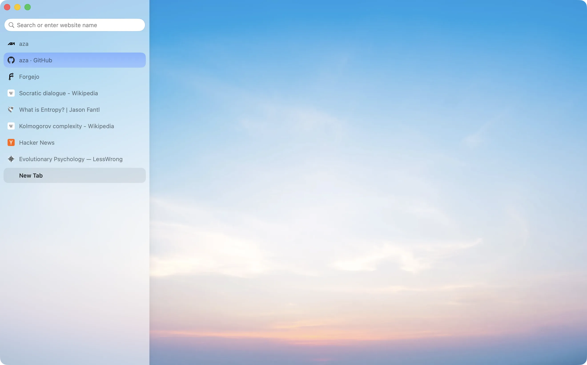

<div align="center">
    
    <h1>Aza Browser</h1>
    <p>
        A private and opinionated macOS browser
    </p>
</div>



## Engine patches

Applied to upstream WebKit (`engine/patches/`).

- Safari's Private Browsing fingerprinting protections are forced on: canvas and audio readouts get noise, `screen` reports the window's size, and link-decoration parameters are stripped.
- `navigator.hardwareConcurrency` is always 8.
- Each tab identity carries a seed; every site's noise is derived from that seed and the site, so the fingerprint changes on every wipe and differs between sites.
- No JIT: JavaScriptCore, WebAssembly included, runs on its interpreters only, set before the engine starts.
- Every web process runs in UTC.
- Every WebKit process reports en-US, so `navigator.language`, `Accept-Language` and `Intl` agree.
- WebRTC gathers relay candidates only, so neither your LAN address nor your public IP reaches a page or a peer.

## Browser

- Each tab gets its own data store and network session (cookies, all storage, HTTP cache, HSTS, TLS sessions, connections) and its own web process.
- Every reload and navigation, back and forward included, throws that identity away and loads into a new one.
- Persist (⌘I) keeps a tab's identity until the tab closes, across relaunches.
- Domains on the cookie whitelist keep one jar on disk, shared by all tabs, with one fixed fingerprint seed.
- `window.open` popups (sign-in, 3-D Secure) share their opener's identity and close with it; links opened in a new tab start fresh.
- The user agent is Safari's for the installed macOS.
- HTTPS-only: plain HTTP is upgraded, with a one-load fallback page if the site has no HTTPS. Loopback (`localhost`) is left alone.
- Tracking parameters (`utm_*`, `fbclid`, `gclid` and others) are removed from every navigation.
- Ads and trackers are blocked inside WebKit's networking by content rules compiled from filter lists (uBlock Origin's, EasyList, EasyPrivacy, Peter Lowe's, URLhaus, AdGuard cookie notices), fetched daily without cookies.
- Location, notifications, MIDI, USB, serial, HID, Bluetooth and sensors are always denied; camera and microphone ask every time and the answer isn't kept.
- Downloads open the save panel and keep macOS's quarantine flag; about://downloads lists them.
- Bangs (`!w`, `!gh`, `!yt` and about 300 more) resolve from a table inside the app.
- Favicons are read from the page through WebKit's isolated script world, fetched without cookies, and kept on disk only for sites in History.
- History keeps addresses, titles, visit counts, last-visit times and frecency in SQLite, plus which suggestion you picked for what you typed, for address-bar completion and `about://history`.
- Safari web extensions from apps in Applications turn on in Settings and run on WebKit's extension engine; their own storage is kept.
- No telemetry and no update checks. The only request Browser makes by itself is the daily filter-list fetch.
- No proxy or Tor: use a VPN. iCloud Private Relay is never used, even when it's on for the Mac.

Keyboard shortcuts are at `about://help` (⇧⌘/).

## Build

Requires Apple Silicon, macOS 26, Xcode 27 and about 60 GB of disk.

```bash
engine/build.sh          # WebKit at engine/WEBKIT_COMMIT + engine/patches, ~1 h first time
./build.sh               # build/Browser.app with the engine embedded
./build.sh debug         # debug build
./build.sh release ship  # Developer ID sign + notarize -> build/release/Browser-<version>.dmg
```

Every build requires Browser’s patched engine. Missing or unpatched frameworks stop the build; both the launcher and the executable refuse to start without them, including debug builds. `BROWSER_ENGINE` can name an existing patched runtime’s framework directory, for example `BROWSER_ENGINE=/Applications/Browser.app/Contents/Frameworks ./build.sh` when rebuilding from an installed patched app.

`engine/build.sh rebase` moves to the latest WebKit commit.

`ship` needs a Developer ID Application certificate and one-time notary setup:

```bash
xcrun notarytool store-credentials browser
```

Pushing a `v*` tag runs the same build on the Forgejo runner (`.forgejo/workflows/release.yml`). `release/runner.sh <token>` registers this Mac as that runner. Updates are manual.

## Test

The engine launch/build checks run without opening a browser:

```bash
python3 Tests/engine.py build/Browser.app
```

The UI self-test only works in debug builds:

```bash
build/Browser.app/Contents/MacOS/Browser -browserStore /tmp/browser-test -browserSelfTest YES
```

It logs PASS/FAIL per check, ends with a count and quits, exiting non-zero if any check failed. Every page it loads comes from a web server inside the test, on this Mac, so it needs no internet; each step waits for what it expects rather than a set time, and works with Browser in the background. `-browserStore` uses a separate data folder; `-browserShots <folder>` has the app draw its own window into PNGs at each step (nothing is captured from the screen). `-browserProbe <url> -browserProbeOut <file>` writes a page's text before and after a wipe; it's used for CreepJS.

## Screenshot

`release/screenshot.sh` redraws `release/screenshot.webp` (quality 80) from a debug build: the tabs listed in the script load from the internet into a throwaway data folder, and the new tab page is in front. The settings at the top of the script choose the tabs, the Persist tab, light or dark, and Fill.

## iPhone

`iOS/` is Browser for iPhone, on the system's WebKit: outside the EU and Japan, iOS doesn't let an app bring its own engine. It shares `BrowserKit` with the Mac app, so everything under Browser above holds, except that Safari extensions can't be loaded from other apps and downloads go to Browser's folder in Files. Of the engine patches, iOS keeps no JIT, UTC and en-US through WebKit's own switches, and Safari's Private Browsing protections through `_setNetworkConnectionIntegrityEnabled:`. It loses the seeded noise (Apple's noise can't be seeded) and relay-only WebRTC.

```bash
iOS/build.sh          # simulator build into build/ios
iOS/build.sh device   # signed for, and installed on, a connected iPhone
```

It's installed from Xcode with a developer account, never the App Store: it uses WebKit's private API.

## Licence

MIT, in `LICENSE`. WebKit, which `engine/patches/` changes, keeps its own licences.

## Layout

| Folder | Contents |
|---|---|
| `engine/` | WebKit commit, patches, build/embed scripts, launcher |
| `BrowserKit/` | Tabs, identities, blocker, bangs, history, extensions |
| `App/` | Window, sidebar, settings |
| `Tests/` | End-to-end app self-test |
| `release/` | Info.plist, entitlements, icon, notarization, runner setup |
